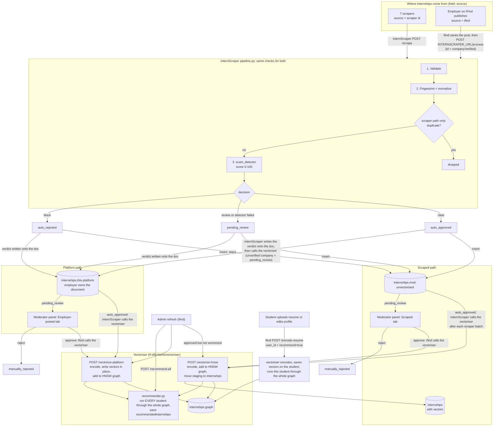
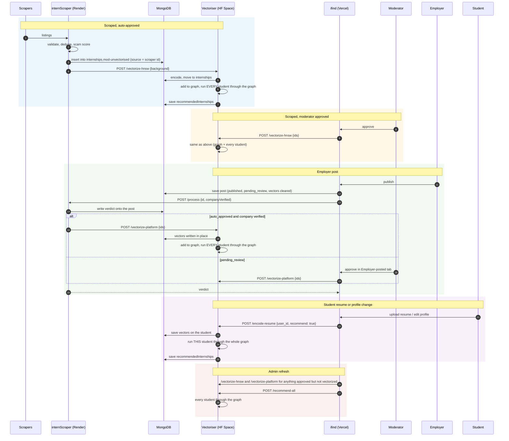

# How an internship moves

Two ways in, one set of checks, one vectoriser. Everything that touches vectors, the HNSW graph or student
recommendations lives in the **vectoriser** service (`tf-idfs+berts/vectoriser`, hosted as a Hugging Face Space).
internScraper and ifind never encode or recommend anything themselves, they only call it.

## 1. The whole picture

## 2. Who calls whom

## 3. Reference

| | Scraped | Employer-posted |
|---|---|---|
| `source` | `github` `internshala` `indeed` `naukri` `unstop` `freshersworld` `letsintern` | `ifind` |
| `moderation.source` | `web_scraping` | `employer` |
| Enters via | `POST /scrape` (background job) | `POST /process` (synchronous, 1 to 50 items) |
| Duplicate check | yes: staging, `internships`, `internships.this-platform` | no (employers may repost) |
| Stored by internScraper | yes, `internships.mod-unvectorised` | no; the verdict is written onto ifind's document while it is `pending_review` |
| Final home | `internships` | `internships.this-platform` (same document) |
| Auto-approved is sent to the vectoriser by | internScraper (`script.py` `_trigger_vectorizer`) | internScraper (`pipeline.py` `apply_platform_verdicts`) |
| Moderator-approved is sent by | ifind (`publishApprovedInternships`) | ifind (`vectorizeIfApproved`) |
| Vectoriser endpoint | `/vectorize-hnsw` | `/vectorize-platform` |
| Enters the HNSW graph | yes | yes |
| After indexing | every student is run through the graph (`recommender.py`) | same |

| Other trigger | Who calls | Vectoriser endpoint | What runs |
|---|---|---|---|
| Student resume / profile change | ifind (`lib/vectorizer.ts`) | `/encode-resume` with `user_id`, `recommend: true` | vectors saved on the student, **that student** runs through the whole graph |
| Admin refresh | ifind (`POST /api/admin/refresh-recommendations`) | `/vectorize-hnsw`, `/vectorize-platform`, then `/recommend-all` | anything approved but unvectorized is sent, then every student (or `userIds`) runs through the graph |

Recommendation rule (`recommender.py`): k-NN over the graph with the student's BERT vector (80 hits), then
score `0.4 x TF-IDF cosine + 0.6 x BERT cosine`, drop scores under 0.1, keep the top 20. Scraped hits must be
`isActive`; employer hits must be `published`, approved, active and before their deadline, so a paused or closed
post drops out of the next pass even though its node stays in the graph.

Score bands: `clear` below 30, `review` 30 to 70, `block` 70 and up. If the detector fails, everything is
`pending_review`; nothing is ever auto-approved without a score. An employer post is auto-approved only when ifind
sends `companyVerified: true`; otherwise a clear listing comes back `pending_review` with `unverified_company`.

## 4. Settings that connect the pieces

| Where | Variable | Purpose |
|---|---|---|
| internScraper | `VECTORISER_URL` | the vectoriser; called after scraping and after an auto-approved employer post |
| internScraper | `MONGODB_URI` | also used by `/process` to record verdicts on `internships.this-platform` |
| internScraper | `FIRST_PARTY_DOMAINS` | iFind's own domains (e.g. `ifind.app`, `localhost:3000` in dev). Without it every employer post looks off-platform and scores into review |
| internScraper | `INTERNSCRAPER_API_KEY` | optional; if set, `/process` requires the `x-api-key` header |
| ifind | `INTERNSCRAPER_URL` | internScraper; unset means every employer post waits for a moderator |
| ifind | `INTERNSCRAPER_API_KEY` | sent as `x-api-key` when set |
| ifind | `VECTORISER_URL` | the vectoriser, for moderator approvals, resume changes and the admin refresh |
| vectoriser | `MONGODB_URI` | required: it reads and writes internships, the graph and students |
| vectoriser | `MAIN_PROJECT_URL`, `INTERNSCRAPER_URL` | origins allowed by CORS (comma-separated); nothing is allowed when unset. Server-to-server calls are unaffected |
| internScraper | `MAIN_URL` | the main project's origin(s) for CORS |
| ifind | `RESUME_EXTRACTOR_URL` | resume extractor (future use: tried before the OpenAI/Gemini fallbacks) |

## 5. Known weak spots

- The vectoriser is one process: pipeline runs and the graph write take a lock, and recommendation passes are
  coalesced (a request that arrives during a pass triggers one more pass at its end). A pass costs one graph
  search per student, so it grows with the number of students; a free Space sleeps and cold-starts slowly.
- Auto-approved posts are sent by internScraper in the background. If the vectoriser is down the post stays approved
  but unvectorized until the next admin refresh (it sends anything approved without vectors).
- If ifind times out waiting for `/process` (30 s) while internScraper still finishes, the document is approved in the
  database but the publish response said `pending_review`; a reload shows the real state.
- `/recommend-all` and the other vectoriser endpoints have no authentication yet.
- A single employer listing is scored without peer data, so the detector is less confident than for a scraped batch.
